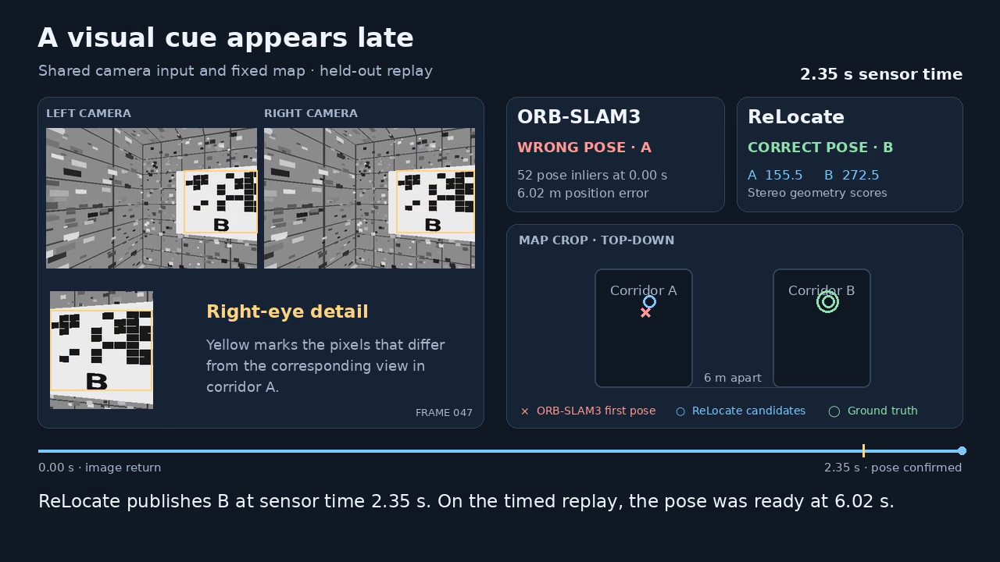

# ReLocate

**Multi-hypothesis relocalization for UAV visual–inertial SLAM.** ReLocate estimates a drone's 6-DoF pose in a fixed map after a camera blackout. When stereo images fit several locations, it keeps a pose for each plausible region and waits for enough evidence to confirm one.

## Demo

[](demo/relocate.mp4)

The 76-second demo shows both methods on the same stereo input. ORB-SLAM3 publishes a pose in the wrong corridor at the first unmasked frame. ReLocate confirms the correct corridor after a distinctive marker enters view. A second clip shows it withholding a pose when the corridors remain visually identical. [Watch the captioned MP4](https://raw.githubusercontent.com/David-Trinh-05/relocate-uav-slam/main/demo/relocate.mp4)

## How it works

1. Retrieve ORB keyframes by map region so nearby views of one location share a hypothesis.
2. Estimate a pose for each region with PnP RANSAC on fixed-map landmarks, then check reprojection in the right camera.
3. Carry each candidate forward with relative gyroscope rotation and update it with the next stereo observation.
4. Publish a pose when the same region leads by a sufficient margin and meets the geometry thresholds for three consecutive frames. Withhold a pose when the evidence stays ambiguous.

## Benchmark results

The benchmark has 18 synthetic stereo–inertial outages across two corridors 6 m apart. Development and held-out splits each contain nine independent simulated trajectories. The cases include immediate, delayed, and absent visual cues. Both methods use the same 42-keyframe reference snapshot. The baseline calls the upstream ORB-SLAM3 relocalization routine on a frozen Atlas.

| Method on 9 held-out outages | Correct first pose | False first pose | No pose within 5 s |
| --- | ---: | ---: | ---: |
| ORB-SLAM3 native relocalization | 6 | 3 | 0 |
| ReLocate, two hypotheses | 6 | 0 | 3 |

ReLocate recovered correctly in two of the baseline's three false-pose cases and withheld a pose in the third. All three baseline errors were about 6 m even though the correct region was in the candidate list. [Paired outcomes and candidate traces](docs/week6.md)

With the same three-frame confirmation rule, keeping two poses reduced keyframe matching calls by **53.1%** versus keeping one, with identical outcomes and publication timestamps. Frame processing on the tested i7-13700H measured **139.64 ms p95**, exceeding the **50 ms** budget for 20 Hz. These measurements describe synthetic fixed-map relocalization. [Controlled comparison](docs/week5.md) · [Wall-clock profiling](docs/week7.md)

## Run locally

Use Python 3.11 or later and run these commands from the repository root.

**Render the demo.** Install Pillow in your Python environment and make FFmpeg with `libx264` and DejaVu Sans available. The renderer uses the camera frames and pose traces in `demo/` and writes `runs/relocate-demo.mp4`.

```bash
python3 -m pip install Pillow
python3 -m demo.render
```

**Reproduce the full benchmark.** Install NumPy, SciPy, and OpenCV, then build the pinned ORB-SLAM3 checkout with relocalization tracing. The script generates and audits the dataset, builds the native adapter, runs the baseline and three ReLocate policies, and prints the comparison. The JSON report and traces are saved under `runs/portfolio-benchmark.*`. [Build instructions for Ubuntu](docs/build.md)

```bash
python3 -m pip install numpy scipy opencv-python-headless
./run-portfolio-benchmark.sh
```

## Documentation

- [Benchmark data and manifest](docs/week3.md)
- [Pose scoring protocol](docs/evaluation.md)
- [Relocalizer design and decision traces](docs/week4.md)
- [EuRoC replay and blackout diagnostics](docs/week2.md)
- [Demo chapters and CV wording](docs/portfolio.md)
- [ORB-SLAM3 patch attribution and license](patches/README.md)
