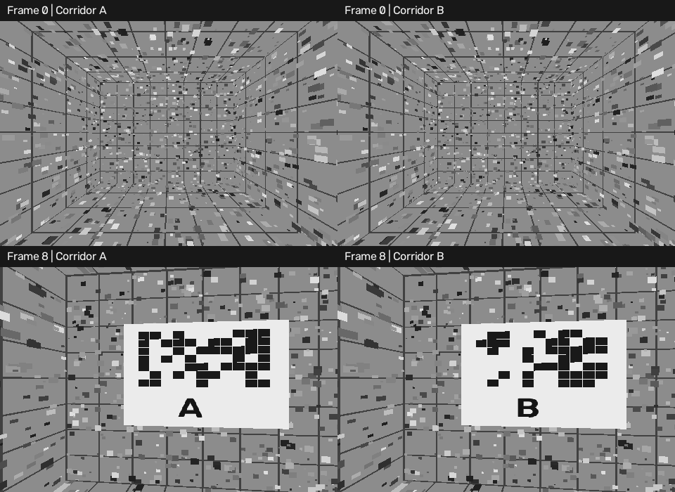

# Week 2 replay and visual ambiguity

## EuRoC image blackout

The stereo–inertial baseline runs in mapping mode. Each replay starts at the beginning of `V1_01_easy` with its own atlas and reads the first 850 stereo pairs. In the four outages, both rectified images are replaced with black images starting at zero-based frame 600. The replay audit checks the camera timeline and the IMU file checksum against the clean control, and verifies the number of IMU samples actually passed into tracking at each frame.

| Image blackout | First OK pose after images return | Tracker result |
| --- | --- | --- |
| None | Frame 600 in map 0 | Clean control |
| 0.5 s | Frame 610 in map 0, 0 ms | Resumed tracking in the original map |
| 1.0 s | Frame 620 in map 0, 0 ms | Resumed tracking in the original map |
| 2.0 s | Frame 643 in map 0, 150 ms | Resumed tracking in the original map |
| 6.0 s | Frame 726 in map 1 | Switched maps before images returned |

The three same-map recoveries used inertial prediction during the loss and reached `OK` through local tracking. Each recovery pose met the position and angle thresholds after rigid alignment using the final five seconds before the blackout. That alignment window was selected for this diagnostic run after checking that the online poses were consistent over that interval. The longer outage left map 0 at frame 701. All five runs logged zero entries into `Tracking::Relocalization()`. These runs provide a baseline for tracking recovery. The false relocalization rate remains unmeasured. [Replay results](../results/week2-euroc-replays.json)

### Reproduce the EuRoC runs

Build ORB-SLAM3, apply the replay patch once, and rebuild the example. The launcher enables instrumentation for a replay and writes `frames.csv`, `replay.json`, and `baseline.log` in a new run directory. `events.csv` is created when the tracker logs an inertial prediction after loss or a relocalization event. When the relocalization path runs, the events include the keyframe IDs, map ID, camera centers and BoW match counts, plus the accepted candidate and its inlier count. [ORB-SLAM3 build](build.md#build-orb-slam3)

```bash
git -C third_party/ORB_SLAM3 apply "$PWD/patches/orb-slam3-replay.patch"
cmake --build third_party/ORB_SLAM3/build --target stereo_inertial_euroc --parallel 2
python3 -m pip install numpy scipy opencv-python-headless

replays=()
for masked in 0 10 20 40 120; do
    run=$(OPENCV_FOR_THREADS_NUM=2 python3 replay.py third_party/ORB_SLAM3 \
        data/V1_01_easy --start-frame 600 --mask-frames "$masked" --limit-frames 850) || exit
    replays+=("$run")
done
python3 inspect_replays.py data/V1_01_easy/mav0/state_groundtruth_estimate0/data.csv "${replays[@]}"
```

## Two physically distinct locations with the same stereo observations

The rendered corridors are translated by 6 m. Their first seven stereo pairs are pixel-identical, including while the camera turns. For the first frame, ORB matches and PnP yield **175 inliers at each pose**. Each pose is within 0.15 m of its own known camera center. The unique rear-wall panels first enter view at zero-based frame 7. At frame 8, the true corridor A has **501 inliers** and corridor B has **142**.

The diagnostic tests geometric confirmation using two supplied reference views at each step, each offset 8 cm from the query's position along the corridor. Their 3D landmarks come from the renderer. It establishes that both hypotheses can be geometrically valid and later images can distinguish them. Reference retrieval, temporal confirmation, and fixed-map ORB-SLAM3 on the synthetic corridor remain to be evaluated. [Ambiguity results](../results/week2-ambiguity.json)

```bash
python3 ambiguity_scene.py runs/ambiguity
```


